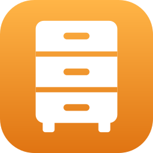
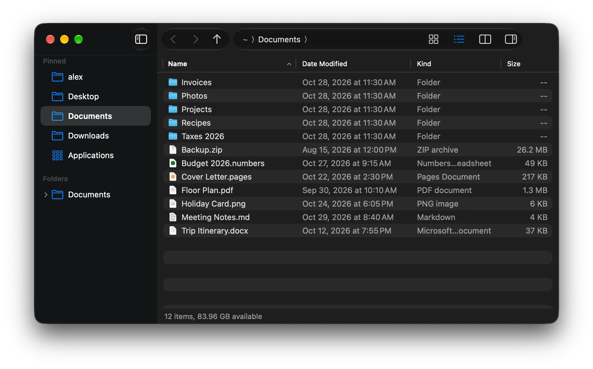

# File Manager

A file manager for macOS with the keyboard habits of Windows Explorer and Linux file managers.
Backspace goes up a folder, F5 refreshes, Opt+D or Cmd+L lets you type a path (with Tab
completion), Cmd+H shows hidden files, and F4 opens a terminal in the current folder. It uses
Cmd where Windows and Linux use Ctrl, and keeps the Mac habits worth keeping, like Return to
rename.

  

  

## What it does

- **Explorer and Linux shortcuts.** Back and forward with Opt+Left/Right or your mouse's side
  buttons, up with Backspace, refresh with F5, move between panes with F6.
- **Split view** (F3): two folders side by side, with Copy / Move to Other Pane.
- **Connect to Server** (Cmd+K) for SMB (including `\\server\share` paths), NFS and WebDAV.
- **Tabs**: Cmd+T, Ctrl+Tab, middle-click to open a folder in a new tab, Shift+Cmd+T to reopen
  a closed one, and your windows and tabs come back next time.
- **An Explorer-style address bar**: click any folder in the path or pick from its › menu, or
  click the empty part to type a path with Tab completion.
- **A sidebar** with pinned folders, recent folders, drives with Eject, and a folder tree that
  follows where you are.
- **A details list that behaves.** Folders first, natural number sorting (`file2` before
  `file10`), type-ahead, resizable columns, and live updates when files change.
- **Cut and paste that moves files**, folder merging like Explorer, Replace / Keep Both / Skip
  when names clash, F2 to rename, and one undo history for everything (copies, moves, renames,
  new folders, trashing).
- **Drag and drop** that moves on the same disk and copies across disks (Opt copies, Cmd
  moves), spring-loaded folders, and drops onto sidebar places.
- **A right-click menu** (also Shift+F10) with Open With, Share and Services, **Get Info** with
  folder sizes and permissions (Cmd+I or Opt+Return), and **Quick Look** on Space.
- **Details or icons** for each folder, remembered per folder: thumbnails, zoom (Cmd+= / Cmd+-
  or Cmd+scroll), extra columns (Date Created, Date Added, Extension, Permissions), groups by
  kind, date or size like Explorer, and a preview pane (Opt+P).
- **Find as you type** (Cmd+F) in the folder or all its subfolders, with wildcards (`*.jpg`)
  and kind, date and size filters; **Invert Selection** and **Select by Pattern**.
- **Batch rename** with find and replace, regular expressions, case changes and numbering,
  with a live preview and a single undo.
- **Works with Finder and iCloud**: Open With and a Services item to open folders from other
  apps, Finder tags (show, set, filter), iCloud download status with Download Now / Remove
  Download, and zip Compress / Extract.
- **Your own shortcuts** in a small JSON file, on top of the standard ones.
- **Open Terminal Here** in Terminal, iTerm, Ghostty or any app you choose.
- **A full menu bar** with every action and its shortcut, so nothing is hidden.

## Download

File Manager needs macOS 27 or later. Get the latest version from the
[Releases](../../releases) page, unzip it and move **File Manager.app** to Applications. The
first time you open it, macOS asks you to confirm; the [installing guide](docs/Installing.md)
shows how, and how to build it yourself instead.

## Documentation

**[Read the documentation](docs/Home.md)** for how to use the app, for example:

- [What are all the keyboard shortcuts?](docs/Keyboard-Shortcuts.md)
- [Why does Return rename instead of open?](docs/Coming-from-Windows-and-Linux.md#return-renames-it-doesnt-open)
- [How do I type a path, and what does Tab do?](docs/Using-the-App.md#typing-a-path)
- [What happens when I paste a folder onto one with the same name?](docs/Copying-and-Moving-Files.md#folders-merge)
- [A folder says "Can't Open Folder"](docs/Troubleshooting.md)

## For developers

Building, testing, VS Code setup, the code layout and releases are covered in the
[developer guide](docs/Developer-Guide.md).

## License

[MIT](LICENSE)
