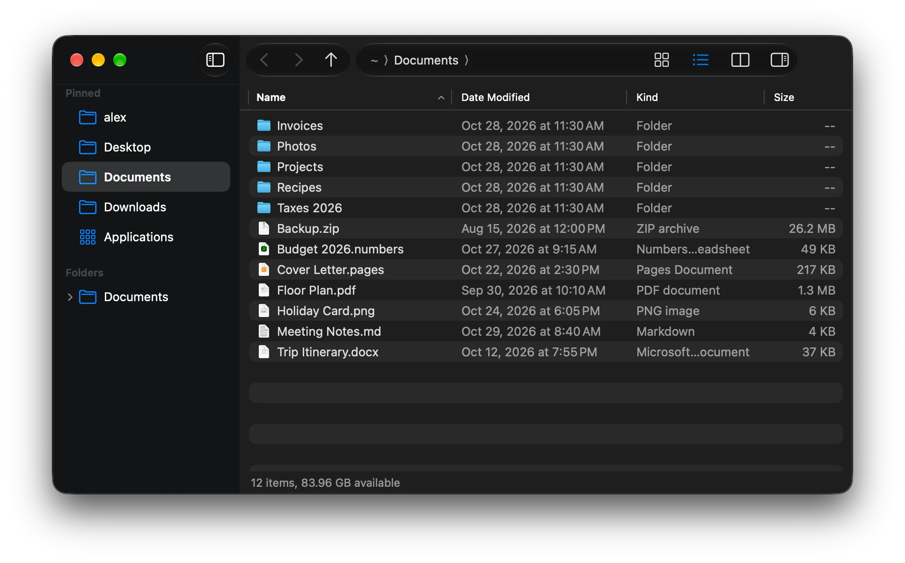

# Using the app

Each File Manager window shows one folder. Open more windows with **Cmd+N**.



```
┌─────────────────────────────────────────────────────────────────────────┐
│ ‹  ›  ↑   Documents   [ ~/Documents                                   ] │ ← toolbar
├──────────────┬──────────────────────────────────────────────────────────┤
│ Favorites    │ Name                 Date Modified       Kind      Size   │
│  ⌂ Home      │ 📁 Projects          Oct 2, 2026 9:14    Folder      --   │
│  ▭ Desktop   │ 📁 Receipts          Sep 30, 2026 18:02  Folder      --   │
│  ▤ Documents │ 📄 notes.txt         Oct 28, 2026 22:40  Plain Text  2 KB │
│  ↓ Downloads │                                                          │
│  ⊞ Apps      │                                                          │
│ Locations    │                                                          │
│  ▣ Macintosh │                                                          │
│              ├──────────────────────────────────────────────────────────┤
│              │ 3 items, 1 selected                                      │ ← status bar
└──────────────┴──────────────────────────────────────────────────────────┘
```

## The toolbar

- **‹ ›** go back and forward through the folders you've visited in this window
  (Opt+Left / Opt+Right, Cmd+[ / Cmd+], or the back and forward buttons on your mouse).
- **↑** goes to the enclosing folder (Backspace, Opt+Up or Cmd+Up). The folder you came from is
  selected, so you can go straight back down with Cmd+Down.
- **The address bar** shows where you are. `~` means your home folder.

## Typing a path

Press **Cmd+L** (or Opt+D, as on Windows) to jump to the address bar, then type and press
**Return**. You can type:

| You type | Goes to |
|---|---|
| `/Applications` | that exact folder |
| `~/Downloads` | Downloads in your home folder |
| `Projects` | a folder inside the current one |
| `..` | the enclosing folder |
| `~/Documents/notes.txt` | the Documents folder, with `notes.txt` selected |

**Tab** completes folder names as you type: `~/Doc` then Tab becomes `~/Documents/`. If several
folders match, Tab fills in as much as they have in common. Names are matched regardless of
case, and hidden folders are only suggested once you type the leading `.`.

**Esc** puts the address back as it was and returns to the file list.

## The sidebar

**Favorites** has your home folder, Desktop, Documents, Downloads, Applications and iCloud Drive.
**Locations** lists your Mac's disk and any mounted drives, disk images or network shares; it
updates when you connect or eject one. Click an item to open it.

## The file list

- **Open** a folder or file by double-clicking it, or select it and press Cmd+O, Cmd+Down or
  Cmd+Return. Folders open in the same window; files open in their default app. Return doesn't
  open: it renames, as in Finder.
- **Select** with the arrow keys, Shift for a range, Cmd+click to add or remove one item, and
  Cmd+A for everything.
- **Type a name** to jump to it: typing `rec` selects the first item starting with "rec".
- **Sort** by clicking a column heading; click again to reverse. View → Sort By does the same.
  Folders stay at the top unless you turn that off in [Settings](Settings.md).
- **Resize and reorder** columns by dragging their edges and headings. The layout is remembered.

Hidden files (names starting with `.`, and files marked hidden) are off by default. **Cmd+H** or
**Cmd+Shift+.** (View → Show Hidden Files) shows them, dimmed; press again to hide them. The
status bar says when they're shown.

The list updates by itself when files are added, removed or renamed in the folder. **F5** or
**Cmd+R** refreshes it by hand.

## Working with files

The File and Edit menus have everything for changing files: **New Folder**, **New Text File**,
**Rename** (Return or F2), **Duplicate**, **Cut**, **Copy**, **Paste**, **Copy Path**,
**Move to Trash** (Cmd+Backspace or Delete), **Delete Immediately…** and **Put Back**, and
**Undo** for all of them. [Copying and moving files](Copying-and-Moving-Files.md) explains each
one, what happens when names clash, and how folders merge.

## Moving around with the keyboard

**F6** moves the keyboard focus between the sidebar, the address bar and the file list, like F6
in Explorer; **Shift+F6** goes the other way. Tab works too, as in any Mac window.

## Open Terminal Here

**F4** or **Cmd+Opt+T** (Go → Open Terminal Here) opens the current folder in your terminal app.
It's Terminal unless you pick another one in [Settings](Settings.md).

---
Next: [Copying and moving files](Copying-and-Moving-Files.md)
